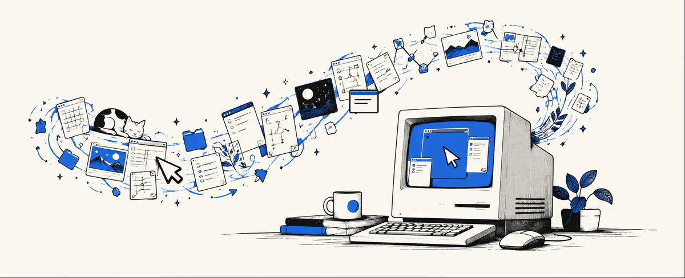
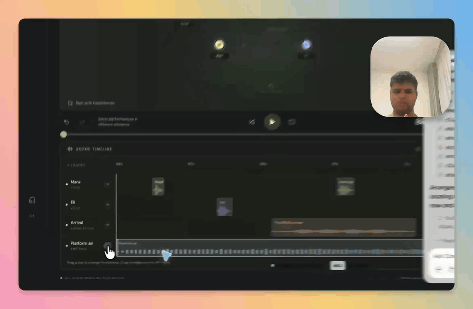

# hey, i'm akshat :)

you get better at your job every week.

your computer? pretty much the same as it was last year.

i'm building [barestate](https://barestate.xyz) with my friend vivek to change that. we're working on machines that get better with use, starting with computers.

we've known each other since we were kids. back then we took apart antivirus software and reverse engineered games. later, we built an operating system together.

now we're back at it, trying to make computers a little more capable :)

**atom** is our small model for computer use. it runs locally on apple silicon and finds things on a screen. its runtime package is 169 mb, and it found 966 out of 1,272 targets on screenspot-v2 in one pass. [the predictions and evaluation are public.](https://github.com/akshatcoder-hash/atom-screenspot-v2)

here's orb working across a real app:

**orbit** is our research into models that can learn from how you use your computer. the idea is that your machine should get better at *your* work over time.

i've also been building [ranger](https://ranger.akshats.xyz), an ai engineer that goes from a customer conversation to a scoped code change, and trace, the code intelligence system it uses to investigate repositories.

before all this, i founded surfcash.

[portfolio](https://akshats.xyz) · [barestate](https://barestate.xyz) · [ranger](https://ranger.akshats.xyz) · [linkedin](https://www.linkedin.com/in/akshatcoder/) · [x](https://twitter.com/akshatwts)
